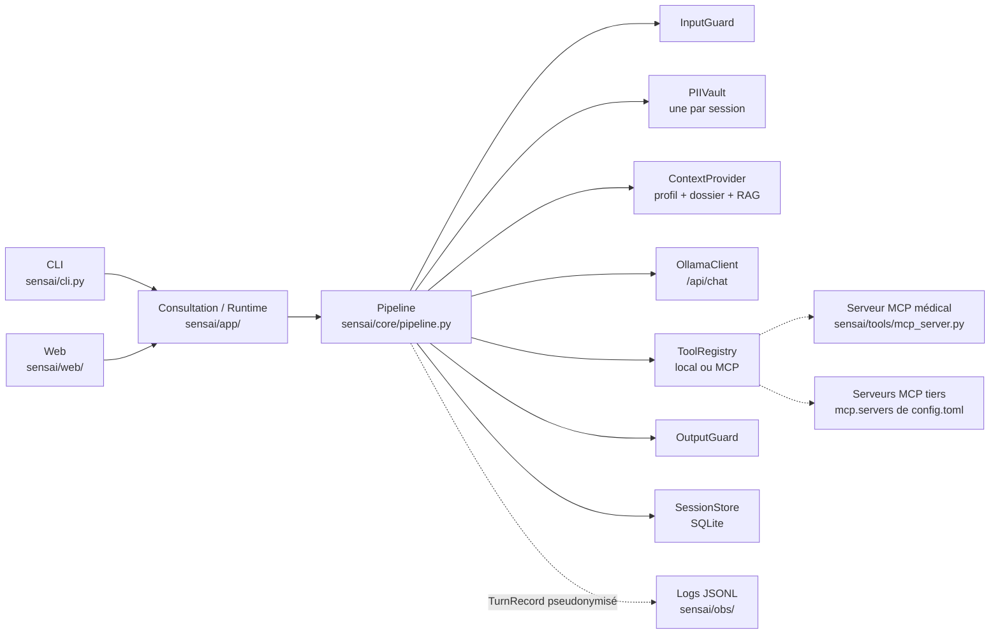

# Architecture et contexte

## Vue d'ensemble

La CLI et le web ne contiennent pas de logique : ils affichent les événements d'une
**consultation** (`sensai/app/`), qui appelle le **pipeline** (`sensai/core/pipeline.py`).
Le pipeline est le seul endroit qui pseudonymise et ré-identifie.



Les modules communiquent par les contrats de `sensai/core/interfaces.py` (`InputGuard`,
`PIIVault`, `OutputGuard`, `ContextProvider`, `SessionStore`, `ToolRegistry`, `Event`).
Chaque membre a codé son module contre ce fichier ; `sensai/core/defaults.py` fournit des
versions neutres pour tester le pipeline seul.

## Un tour, étape par étape

1. `InputGuard.check(texte)` : requête bloquée → événement `error`, fin.
2. Chargement de la session, puis du coffre : `vault = vault_factory(state.pii_map)`.
3. `masked = vault.mask(texte)` ; `ctx = ContextProvider.provide(texte, masked, sid)`.
   Le texte **en clair** ne sert qu'à chercher le patient dans SQLite ; l'embedding RAG
   reçoit **uniquement** `masked`.
4. Messages envoyés : prompt système + contexte (chaque `content` masqué) + derniers tours
   de l'historique + question masquée.
5. Streaming : chaque fragment passe par un tampon qui retient un `[…]` en cours (24
   caractères au plus), puis `vault.reveal` → événement `token` **en clair** pour le médecin.
6. Appel d'outil : `vault.reveal_args` → l'outil reçoit le vrai nom ; si l'outil est
   dangereux, événement `confirm` et attente du médecin ; le résultat est masqué avant de
   repartir au modèle (au plus `max_tool_iterations` relances).
7. Fin : `OutputGuard.check(vault.mask(réponse complète))`, puis écriture dans l'historique.
8. Hook `on_turn(TurnRecord)` → logs (pseudonymisés), puis événements `usage` et `done`.

## Frontière des données personnelles

| Côté **clair** (local) | Côté **pseudonymisé** |
|---|---|
| recherche du patient dans SQLite | tout message envoyé au modèle de chat |
| arguments et résultats des outils | la requête d'embedding RAG |
| affichage CLI et web, tous les `Event` | l'historique stocké |
| la confirmation (le médecin doit voir le vrai nom) | les logs |

Pourquoi masquer aussi l'embedding, qui est local ? Tout ce qui sort du pipeline vers un
modèle est pseudonymisé : un modèle peut ainsi être déplacé vers un service distant sans
rouvrir la question. Le corpus RAG ne contient que des documents publics.

## Ce que le modèle reçoit (prompt exact)

Le prompt exact du dernier tour s'affiche avec `/prompt` (CLI), le bouton « Voir le prompt
envoyé » (web) ou `GET /api/sessions/{id}/prompt`. Il est aussi dans chaque ligne de log.

Exemple réel, tiré de `logs/2026-10-23.jsonl` (profil `generaliste`, dossier de Mme Dupont,
question sur le dossier seul, donc sans recherche documentaire) — 344 tokens lus :

```text
[system] Tu es Sensai, l'assistant d'un cabinet médical. Tu tournes entièrement en local.
         Réponds en français, de façon brève et factuelle.
         Appuie-toi uniquement sur le dossier patient et les notices fournis dans le contexte, et cite tes sources.
         Si l'information manque, dis-le au lieu de l'inventer.
         Tu ne modifies jamais un dossier sans la validation explicite du médecin.
[system] Profil médecin : generaliste
         Spécialité : Médecine générale
         Préférences : Réponses courtes
         Instructions personnalisées : Citer les sources disponibles
[system] [Source : dossier patient local SQLite]
         Patient : [PATIENT_1]
         Date de naissance : [NAISSANCE_1]
         Allergies : Pénicilline : urticaire et œdème de Quincke en 2019
         Traitements : Amlodipine 5 mg/j
         Antécédents : Hypertension artérielle ; Appendicectomie en 1989
         Notes : Dernière consultation : bilan tensionnel satisfaisant.
         Réponds uniquement sur ce patient. Une liste vide n'atteste pas l'absence médicale
         d'une allergie. Les documents publics éventuels sont fournis séparément. Pour ajouter
         une note, utilise add_patient_note avec le nom du patient et une note textuelle.
         L'outil demandera la confirmation du médecin.
[user]   Quelles allergies sont enregistrées pour [PATIENT_1] ?
```

Réponse enregistrée : « L'allergie enregistrée pour [PATIENT_1] est à l'acide pénicilline,
avec urticaire et œdème de Quincke en 2019. » (« acide » est une erreur du modèle : voir
[Limites](limites.md#modele)).

Quand la question porte sur un médicament, un quatrième message système ajoute les extraits
numérotés `[S1]`, `[S2]` avec titre, éditeur, page, date et URL de la source.

## Budget de contexte

Le contexte est **plafonné et suivi** à chaque tour.

| Élément | Plafond | Réglage |
|---|---|---|
| fenêtre totale du modèle | 2 048 tokens | `[model] num_ctx` |
| réponse | 128 tokens | `[model] num_predict` |
| historique envoyé | 4 derniers tours (un tour n'est jamais coupé entre un outil et son résultat) | `[assistant] max_history_turns` |
| extraits documentaires | 3 extraits, 2 600 caractères sources comprises | `[rag] top_k`, `max_context_chars` |
| schémas d'outils | seulement ceux utiles à la demande | routage dans `sensai/app/tool_routing.py` |

Suivi : après chaque réponse, la CLI affiche `tokens : 773 lus + 17 générés · contexte
790/2048` ; le web affiche le même compteur ; chaque log garde `context_tokens` ; le tableau
de bord donne le maximum observé (918 tokens sur les tours du 23/10).
