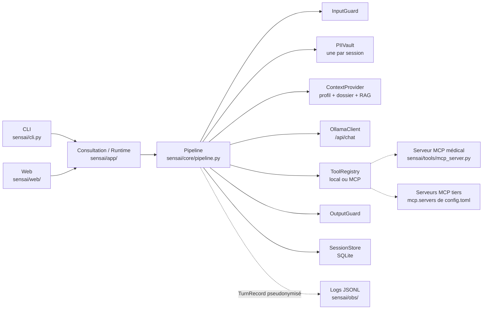

# Architecture et contexte

## Vue d'ensemble

La CLI et le web ne contiennent pas de logique : ils affichent les événements d'une
**consultation** (`sensai/app/`), qui appelle le **pipeline** (`sensai/core/pipeline.py`).
Le pipeline est le seul endroit qui pseudonymise et ré-identifie.

Les modules communiquent par les contrats de `sensai/core/interfaces.py` (`InputGuard`,
`PIIVault`, `OutputGuard`, `ContextProvider`, `SessionStore`, `ToolRegistry`, `Event`).
Chaque membre a codé son module contre ce fichier ; `sensai/core/defaults.py` fournit des
versions neutres pour tester le pipeline seul.

## Un tour, étape par étape

1. `InputGuard.check(texte)` : requête bloquée → événement `error`, fin.
2. Chargement de la session, puis du coffre : `vault = vault_factory(state.pii_map)`.
3. `masked = vault.mask(texte)` ; `ctx = ContextProvider.provide(texte, masked, sid)`.
   Le texte **en clair** ne sert qu'à chercher le patient dans SQLite ; l'embedding RAG
   reçoit **uniquement** `masked`.
4. Messages envoyés : prompt système + contexte (chaque `content` masqué) + derniers tours
   de l'historique + question masquée.
5. Streaming : chaque fragment passe par un tampon qui retient un `[…]` en cours (24
   caractères au plus), puis `vault.reveal` → événement `token` **en clair** pour le médecin.
6. Appel d'outil : `vault.reveal_args` → l'outil reçoit le vrai nom ; si l'outil est
   dangereux, événement `confirm` et attente du médecin ; le résultat est masqué avant de
   repartir au modèle (au plus `max_tool_iterations` relances).
7. Fin : `OutputGuard.check(vault.mask(réponse complète))`, puis écriture dans l'historique.
8. Hook `on_turn(TurnRecord)` → logs (pseudonymisés), puis événements `usage` et `done`.

## Frontière des données personnelles

| Côté **clair** (local) | Côté **pseudonymisé** |
|---|---|
| recherche du patient dans SQLite | tout message envoyé au modèle de chat |
| arguments et résultats des outils | la requête d'embedding RAG |
| affichage CLI et web, tous les `Event` | l'historique stocké |
| la confirmation (le médecin doit voir le vrai nom) | les logs |

Pourquoi masquer aussi l'embedding, qui est local ? Tout ce qui sort du pipeline vers un
modèle est pseudonymisé : un modèle peut ainsi être déplacé vers un service distant sans
rouvrir la question. Le corpus RAG ne contient que des documents publics.

## Ce que le modèle reçoit

Le prompt exact (CLI `/prompt`, web, API, logs), la requête HTTP complète envoyée à
Ollama, le choix de ce qui entre dans le contexte, son budget et son suivi sont détaillés
dans [Contexte envoyé au modèle](contexte.md).
